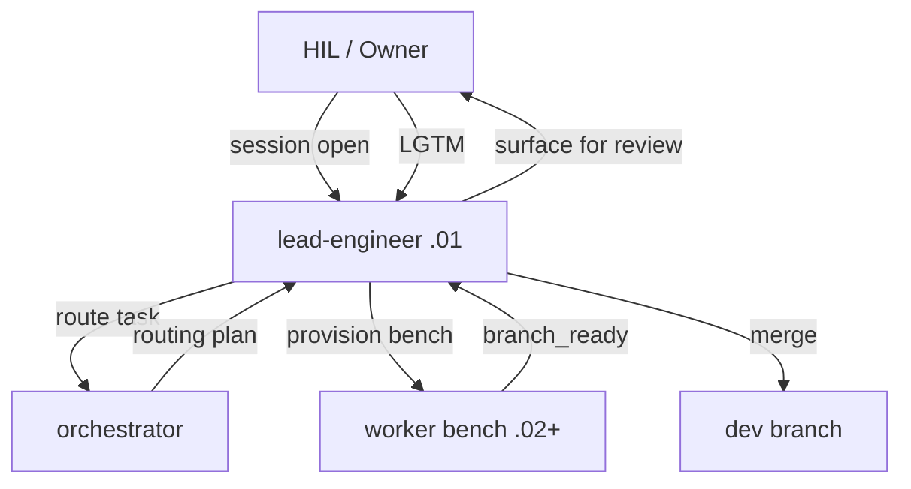

# Agentic Workflow Overview

## What This Framework Does

AgenticCore provides a structured model for running AI agent teams against a
codebase while maintaining human-in-the-loop (HIL) control at all critical gates.

The framework is tool-agnostic: agent definitions are maintained in `.agents/` as
a canonical source and generated for specific AI tools (OpenCode, AI toolchain).

## Workflow Model

## The HIL Acceptance Gate

The Human-in-the-Loop is the owner and final authority. No work lands to `dev` or
`main` without explicit HIL acceptance. The canonical acceptance signal is **"lgtm"**.

Gates that require HIL:
- Every merge to `dev` or `main`
- Every push to remote
- Every worktree teardown
- Every external-facing action (publish, deploy)

## Task Flow

1. Lead-engineer surfaces a `ready` task from `tasks.yaml`
2. Lead-engineer provisions a worker bench (`.02`+) on a branch
3. Worker bench executes the task, commits artifacts
4. Worker bench moves task to `branch_ready`
5. Lead-engineer surfaces for HIL review
6. HIL reviews and signals LGTM
7. Lead-engineer merges branch, moves task to `merged`
8. Bench is torn down (with HIL authorization)

## Agent Roles

| Agent | Mode | Invoked By |
|---|---|---|
| `lead-engineer` | primary | HIL (session open) |
| `attendant` | primary | HIL (Pattern W session open) |
| `orchestrator` | subagent | lead-engineer for complex routing |
| `baseline-steward` | subagent | lead-engineer for framework improvement lifecycle |
| `docs-engineer` | subagent | lead-engineer for documentation work |
| `ai-engineer` | subagent | lead-engineer for AI agent configuration and MCP development |
| `ops-engineer` | subagent | lead-engineer for scripts/automation |
| `release-engineer` | subagent | baseline-steward (framework releases) / lead-engineer (adopter releases) |
| `security-engineer` | subagent | lead-engineer for security controls |
| `security-reviewer` | subagent | lead-engineer for adversarial review |

## Documentation as the Backbone

Every significant action produces a document:
- Architectural decisions → ADR in `mddocs/adr/`
- Operational procedures → Runbook in `mddocs/reference.architecture/`
- Session memory → Session state file in `.core/work/`
- Task tracking → Entry in `tasks.yaml`

This produces a **RAG-friendly corpus** — every decision and procedure is searchable
and discoverable by agents and humans alike.
