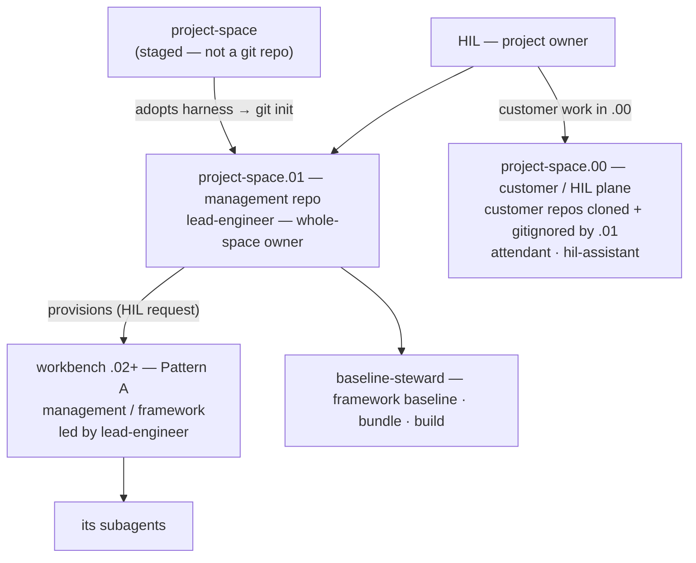
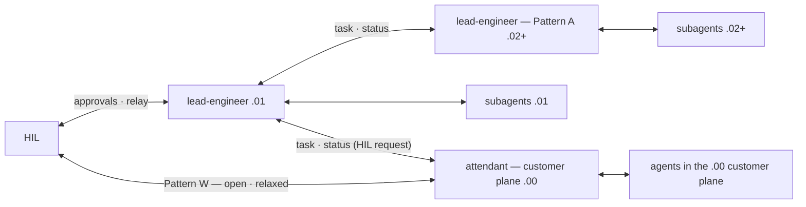
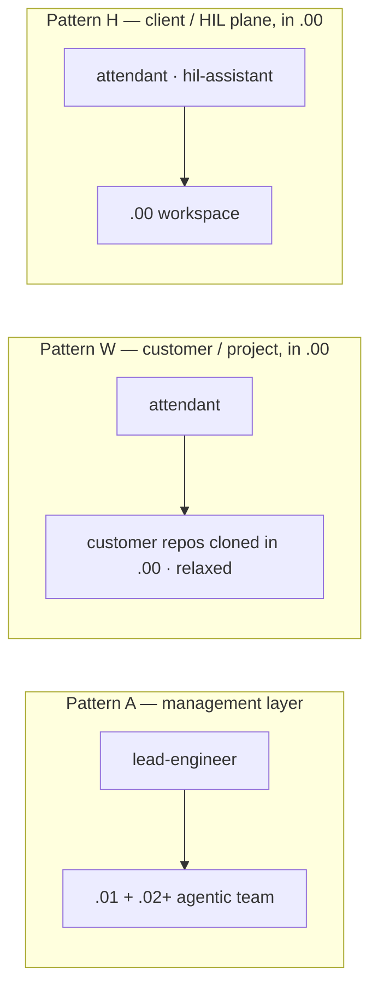
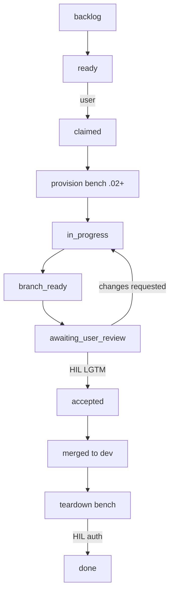

# Visual Overview

A single-page map of how AgenticCore works: the bench hierarchy, how personas map
to workbenches, the workflow lifecycle, and the agent roster. Use this as your
orientation before diving into [Getting Started](getting-started.md) or the
[Agentic Workflow Overview](agentic-workflow-overview.md).

---

## 1. The Bench Hierarchy & Namespace

A **project-space** is identified and staged first. It is **not** a git repository —
it is the start of a structure. When it adopts the AgenticCore harness it becomes
`<project-space>.01`, which is **git-initialized** and becomes the **management repo**
for the project. The lead-engineer owns this space and is accountable for upholding the
governance of the entire space.

**Customer/project work happens in the long-standing `.00` worktree** (the HIL/client
plane): customer repos are cloned into `.00` and **gitignored by `.01`** (ADR-0006 hard
boundary), so customer code never enters management history. Because a git worktree only
materializes **tracked** files, `.02+` worktrees carry only management/framework content
(Pattern A) — they scale well and never see customer code.

### 1a. Hierarchy & Ownership

### 1b. Authority & Communication

### Namespace Summary

| Namespace | Role | Persona | Git state | Lifecycle |
|---|---|---|---|---|
| `.00` | Customer / HIL plane | `attendant` (Pattern W) · `hil-assistant` (Pattern H) | Worktree of `.01`; customer repos cloned here, gitignored | Long-living, never torn down |
| `.01` | Management repo | `lead-engineer` (whole-space owner) | Git-initialized; owns task queue, remote, bench lifecycle | Long-living, never torn down |
| `.02`+ | Management/framework workbenches (Pattern A) | `lead-engineer` (agentic team lead) | Git worktrees provisioned by `.01` | Ephemeral; torn down after HIL auth |

See [Bench Model](bench-model.md) for the canonical detail.

---

## 2. Persona ↔ Workbench (Patterns)

| Pattern | Focus | Namespace | Led / Facilitating | Notes |
|---|---|---|---|---|
| Pattern A | Management layer | `.01` + `.02+` | `lead-engineer` | Framework, harness, guardrails — the core of AgenticCore |
| Pattern W | Customer / project | `.00` | `attendant` | Customer repos cloned into `.00`, gitignored by `.01`; relaxed model |
| Pattern H | Client / HIL plane | `.00` | `attendant` / `hil-assistant` | HIL plane — oversight, coordination |

Customer/project work (Pattern W) happens in the long-standing `.00` worktree: customer
repos are cloned there and gitignored by `.01`, so fresh `.02+` worktrees (Pattern A)
carry only management/framework content. Work intentionally left out of the customer
repo is captured on `.01` management branches for review/test/merge. Everything is
managed officially via `.01` (HIL request & approval). See
[ADR-0028](../adr/adr-0028-customer-plane-provisioning.md).

---

## 3. Workflow Lifecycle

Every piece of work moves through the task-queue lifecycle, gated by the HIL at the
two decision points that matter: **review** and **teardown**.

Key HIL gates:

- **Review** — nothing merges to `dev` or `main` or pushes to remote without an
  explicit `lgtm`.
- **Teardown** — a worker bench is removed only with HIL authorization.
- Any stage can be `cancelled`; `ready` and `accepted` are user-only transitions.

See [Task Queue Operations](../reference.architecture/task-queue-operations.md) and
[Session Open Checklist](../reference.architecture/session-open-checklist.md).

---

## 4. Agent Roster (by Layer)

The `lead-engineer` and `attendant` roles each appear at **two scopes**: the `.01`
management repo / `.02+` management-layer workbenches (Pattern A, `lead-engineer`), and
the `.00` customer/HIL plane (Pattern W `attendant` + Pattern H `hil-assistant`).

| Agent | Layer | Mode | Invoked By | Scope |
|---|---|---|---|---|
| `lead-engineer` | `.01` | primary | HIL (session open) | Whole-space owner & facilitator — governance, task queue, bench lifecycle |
| `lead-engineer` | `.02`+ (Pattern A) | primary | `.01` lead-engineer | Agentic team lead for a management-layer workbench/worktree; completes the assigned task |
| `attendant` | `.00` (Pattern W) | primary | HIL | Facilitates customer/project work in the `.00` plane — relaxed, open to HIL; customer repos cloned here & gitignored by `.01` |
| `hil-assistant` | `.00` (Pattern H) | primary | HIL | HIL's personal collaborator in the `.00` workspace |
| `baseline-steward` | framework | subagent | `.01` lead-engineer | Bundles, builds, and baselines the core framework/harness |
| `orchestrator` | subagent | subagent | lead-engineer (`.01`) | Routing / subagent dispatch |
| `docs-engineer` | subagent | subagent | lead-engineer | Documentation, ADRs, runbooks |
| `docs-reviewer` | subagent | subagent | lead-engineer | Documentation quality gate (verdict only) |
| `code-reviewer` | subagent | subagent | lead-engineer | Code quality gate (verdict only) |
| `ops-engineer` | subagent | subagent | lead-engineer | Scripts, automation, developer tooling |
| `ai-engineer` | subagent | subagent | lead-engineer | Agent config, MCP servers, workflow integration |
| `release-engineer` | subagent | subagent | lead-engineer | CI/CD and tactical release execution |
| `security-engineer` | subagent | subagent | lead-engineer | Security controls, hooks, content inspection |
| `security-reviewer` | subagent | subagent | lead-engineer | Adversarial security review (verdict only) |
| `infra-engineer` | subagent | subagent | lead-engineer | Infrastructure, IaC, networking |
| `ux-engineer` | subagent | subagent | lead-engineer | UI/UX, information architecture, DX |

---

## Related

- [Getting Started](getting-started.md)
- [Agentic Workflow Overview](agentic-workflow-overview.md)
- [Bench Model](bench-model.md)
- [Repository Structure](repository-structure.md)
