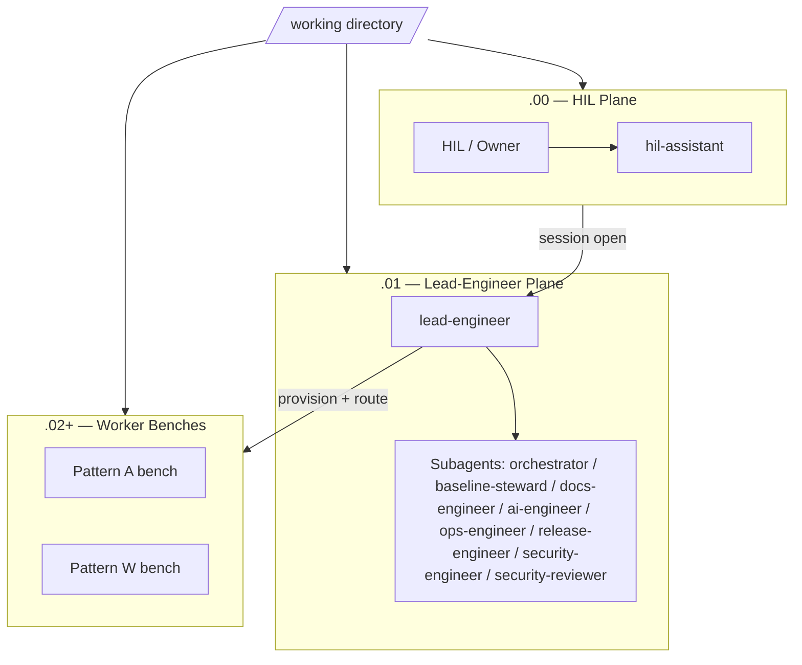
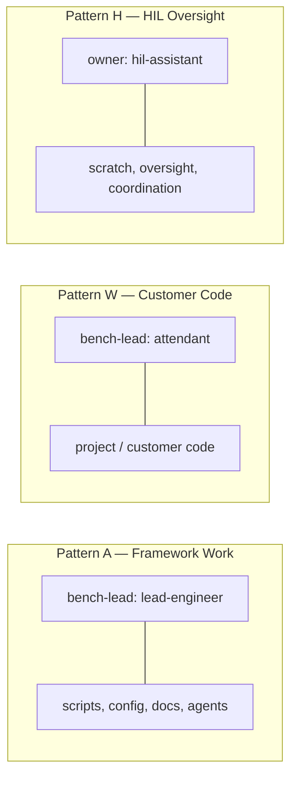
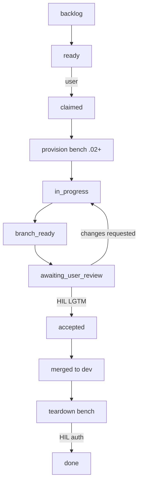

# Visual Overview

A single-page map of how AgenticCore works: the bench hierarchy, how personas map
to workbenches, the workflow lifecycle, and the agent roster. Use this as your
orientation before diving into [Getting Started](getting-started.md) or the
[Agentic Workflow Overview](agentic-workflow-overview.md).

---

## 1. Bench Hierarchy

The repository is split into isolated, parallel workspaces called **benches** — each
one a git worktree on its own branch. Namespaces encode who is allowed to work there:

| Namespace | Role | Lifecycle |
|---|---|---|
| `.00` | HIL workspace — owner/oversight | Long-living, never torn down |
| `.01` | Lead-engineer management plane | Long-living, never torn down |
| `.02`+ | Worker benches (per-ticket) | Ephemeral; torn down after HIL auth |

See [Bench Model](bench-model.md) for full detail.

---

## 2. Persona ↔ Workbench (Patterns)

The framework ships three bench patterns. Each defines which persona leads a bench
and what kind of work lands there:

| Pattern | Namespace | Bench-Lead / Owner | Work |
|---|---|---|---|
| Pattern A | `.02`+ | `lead-engineer` | Framework management (scripts, config, docs) |
| Pattern W | `.02`+ | `attendant` | Customer/project code |
| Pattern H | `.00` | `hil-assistant` (owner) | HIL scratch, oversight, coordination |

---

## 3. Workflow Lifecycle

Every piece of work moves through the task-queue lifecycle, gated by the HIL at the
two decision points that matter: **review** and **teardown**.

Key HIL gates:

- **Review** — nothing merges to `dev` or `main` or pushes to remote without an
  explicit `lgtm`.
- **Teardown** — a worker bench is removed only with HIL authorization.
- Any stage can be `cancelled`; `ready` and `accepted` are user-only transitions.

See [Task Queue Operations](../reference.architecture/task-queue-operations.md) and
[Session Open Checklist](../reference.architecture/session-open-checklist.md).

---

## 4. Agent Roster

| Agent | Mode | Invoked By | Scope |
|---|---|---|---|
| `lead-engineer` | primary | HIL (session open) | Owns `.01`, task queue, routing |
| `attendant` | primary | HIL (Pattern W session open) | Bench-leads customer-code work |
| `hil-assistant` | primary | HIL | Patterns H workspace |
| `orchestrator` | subagent | lead-engineer | Routing/subagent dispatch |
| `baseline-steward` | subagent | lead-engineer | Framework improvement lifecycle |
| `docs-engineer` | subagent | lead-engineer | Documentation |
| `ai-engineer` | subagent | lead-engineer | Agent config, MCP development |
| `ops-engineer` | subagent | lead-engineer | Scripts/automation |
| `release-engineer` | subagent | lead-engineer | CI/CD and releases |
| `security-engineer` | subagent | lead-engineer | Security controls |
| `security-reviewer` | subagent | lead-engineer | Adversarial review |
| `code-reviewer` | subagent | lead-engineer | Code quality review |
| `docs-reviewer` | subagent | lead-engineer | Docs review |
| `infra-engineer` | subagent | lead-engineer | Infrastructure |
| `ux-engineer` | subagent | lead-engineer | UX |

---

## Related

- [Getting Started](getting-started.md)
- [Agentic Workflow Overview](agentic-workflow-overview.md)
- [Bench Model](bench-model.md)
- [Repository Structure](repository-structure.md)
