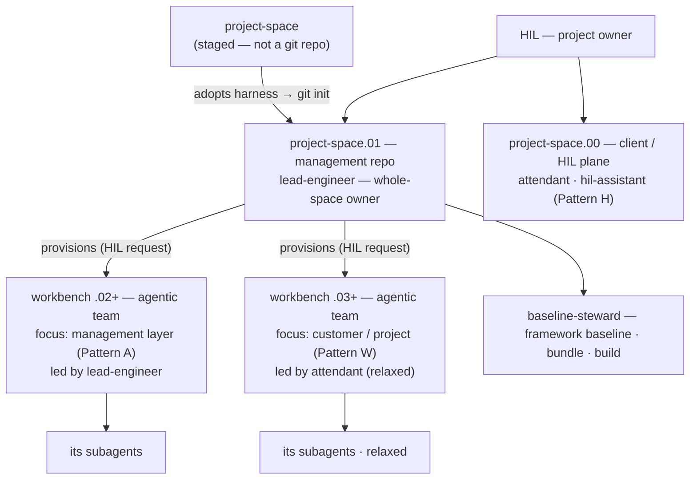
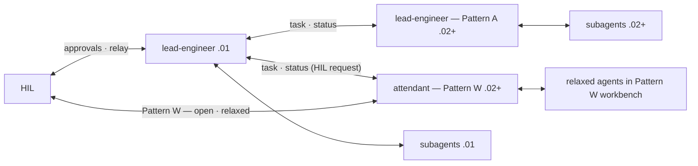
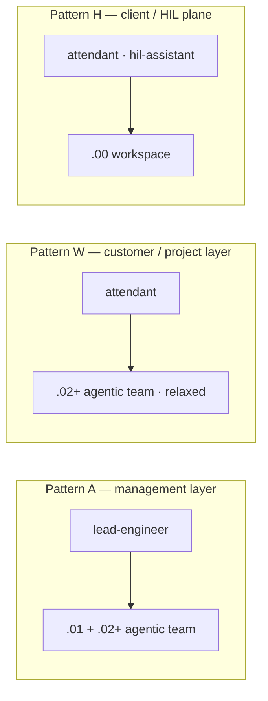
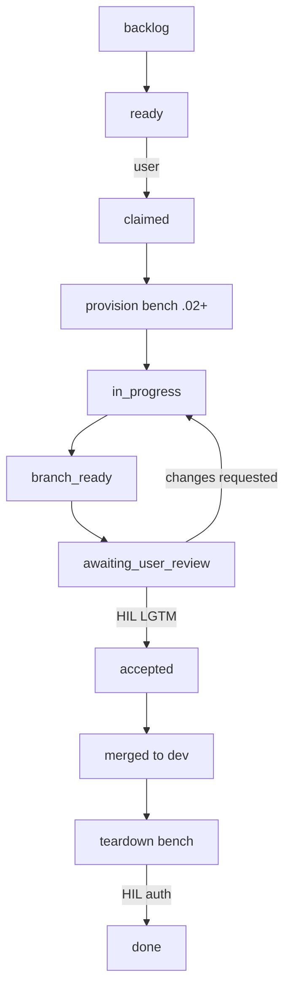

# Visual Overview

A single-page map of how AgenticCore works: the bench hierarchy, how personas map
to workbenches, the workflow lifecycle, and the agent roster. Use this as your
orientation before diving into [Getting Started](getting-started.md) or the
[Agentic Workflow Overview](agentic-workflow-overview.md).

---

## 1. The Bench Hierarchy & Namespace

A **project-space** is identified and staged first. It is **not** a git repository —
it is the start of a structure. When it adopts the AgenticCore harness it becomes
`<project-space>.01`, which is **git-initialized** and becomes the **management repo**
for the project. The lead-engineer owns this space and is accountable for upholding the
governance of the entire space. Each `.02+` workbench is an **agentic team** with one of
two core focus areas: the **management layer** (Pattern A) or the **customer/project
layer** (Pattern W).

### 1a. Hierarchy & Ownership

### 1b. Authority & Communication

### Namespace Summary

| Namespace | Role | Persona | Git state | Lifecycle |
|---|---|---|---|---|
| `.00` | Client / HIL plane (Pattern H) | `attendant` · `hil-assistant` | Worktree of the repo | Long-living, never torn down |
| `.01` | Management repo | `lead-engineer` (whole-space owner) | Git-initialized; owns task queue, remote, bench lifecycle | Long-living, never torn down |
| `.02`+ | Workbenches (Pattern A / W) | `lead-engineer` (Pattern A) · `attendant` (Pattern W) | Git worktrees provisioned by `.01` at HIL request | Ephemeral; torn down after HIL auth |

See [Bench Model](bench-model.md) for the canonical detail.

---

## 2. Persona ↔ Workbench (Patterns)

| Pattern | Focus | Namespace | Led / Facilitating | Notes |
|---|---|---|---|---|
| Pattern A | Management layer | `.01` + `.02+` | `lead-engineer` | Framework, harness, guardrails — the core of AgenticCore |
| Pattern W | Customer / project layer | `.02+` | `attendant` | Relaxed model; workbench provisioned by `.01` at HIL request only |
| Pattern H | Client / HIL plane | `.00` | `attendant` / `hil-assistant` | Client workspace — tasks, priorities, POCs |

Every `.02+` workbench is an agentic team focused on one of the two core areas above
(management layer or customer/project layer). Workbenches are provisioned for Pattern A
and Pattern W by the `.01` lead-engineer; Pattern W is provisioned at **HIL request only**.
Everything is managed officially via `.01` (HIL request & approval).

---

## 3. Workflow Lifecycle

Every piece of work moves through the task-queue lifecycle, gated by the HIL at the
two decision points that matter: **review** and **teardown**.

Key HIL gates:

- **Review** — nothing merges to `dev` or `main` or pushes to remote without an
  explicit `lgtm`.
- **Teardown** — a worker bench is removed only with HIL authorization.
- Any stage can be `cancelled`; `ready` and `accepted` are user-only transitions.

See [Task Queue Operations](../reference.architecture/task-queue-operations.md) and
[Session Open Checklist](../reference.architecture/session-open-checklist.md).

---

## 4. Agent Roster (by Layer)

The `lead-engineer` and `attendant` roles each appear at **two scopes**: the `.01`
management plane / `.02+` management-layer workbenches (Pattern A), and the `.00`
client plane / `.02+` customer-project workbenches (Pattern W).

| Agent | Layer | Mode | Invoked By | Scope |
|---|---|---|---|---|
| `lead-engineer` | `.01` | primary | HIL (session open) | Whole-space owner & facilitator — governance, task queue, bench lifecycle |
| `lead-engineer` | `.02`+ (Pattern A) | primary | `.01` lead-engineer | Agentic team lead for a management-layer workbench/worktree; completes the assigned task |
| `attendant` | `.02`+ (Pattern W) | primary | `.01` lead-engineer (HIL request) | Agentic lead for a customer/project workbench — relaxed model, open to HIL |
| `attendant` | `.00` (Pattern H) | primary | HIL | Facilitates client/POC workspace tasks and priorities |
| `hil-assistant` | `.00` | primary | HIL | HIL's personal collaborator in the `.00` workspace |
| `baseline-steward` | framework | subagent | `.01` lead-engineer | Bundles, builds, and baselines the core framework/harness |
| `orchestrator` | subagent | subagent | lead-engineer (`.01`) | Routing / subagent dispatch |
| `docs-engineer` | subagent | subagent | lead-engineer | Documentation, ADRs, runbooks |
| `docs-reviewer` | subagent | subagent | lead-engineer | Documentation quality gate (verdict only) |
| `code-reviewer` | subagent | subagent | lead-engineer | Code quality gate (verdict only) |
| `ops-engineer` | subagent | subagent | lead-engineer | Scripts, automation, developer tooling |
| `ai-engineer` | subagent | subagent | lead-engineer | Agent config, MCP servers, workflow integration |
| `release-engineer` | subagent | subagent | lead-engineer | CI/CD and tactical release execution |
| `security-engineer` | subagent | subagent | lead-engineer | Security controls, hooks, content inspection |
| `security-reviewer` | subagent | subagent | lead-engineer | Adversarial security review (verdict only) |
| `infra-engineer` | subagent | subagent | lead-engineer | Infrastructure, IaC, networking |
| `ux-engineer` | subagent | subagent | lead-engineer | UI/UX, information architecture, DX |

---

## Related

- [Getting Started](getting-started.md)
- [Agentic Workflow Overview](agentic-workflow-overview.md)
- [Bench Model](bench-model.md)
- [Repository Structure](repository-structure.md)
