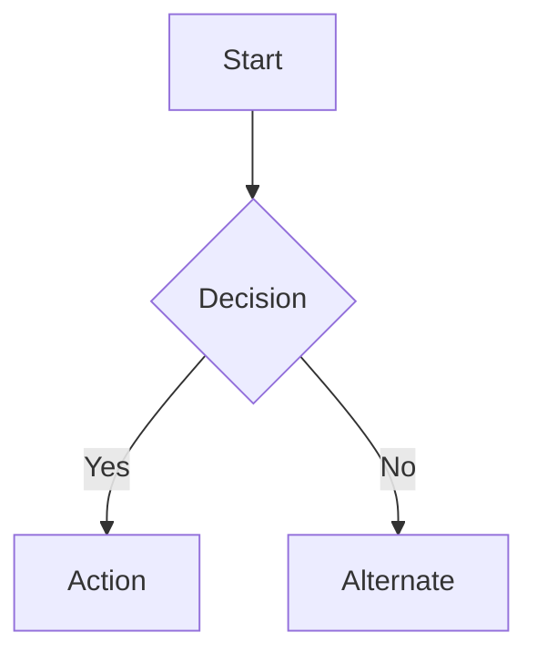

# Runbook: Set Up mddoc Local Documentation Site

## Overview

Installs and configures the tools needed to build and serve the `mddocs/` documentation
site locally using [mdbook](https://rust-lang.github.io/mdBook/) with Mermaid diagram
support. Run this once per machine, then run the per-checkout step for each new clone.

## Prerequisites

- Access: none — local machine setup only
- Tools: `cargo` (Rust package manager) — install from [rustup.rs](https://rustup.rs) if not present
- State: `mddocs/` directory cloned from the repository

## Steps

### 1. Install or update Rust

```bash
# First-time install
curl --proto '=https' --tlsv1.2 -sSf https://sh.rustup.rs | sh

# Update an existing installation
rustup update stable
```

Verify:
```bash
rustc --version   # should be 1.88.0 or later
```

### 2. Install mdbook and mdbook-mermaid

```bash
cargo install mdbook mdbook-mermaid
```

Verify:
```bash
mdbook --version
mdbook-mermaid --version
```

### 3. Run the per-checkout setup

This step is only needed after upgrading `mdbook-mermaid` to refresh the
bundled JS assets. `mermaid.min.js` and `mermaid-init.js` are committed to the
repository and do not need to be regenerated on each clone.

```bash
cd mddocs
mdbook-mermaid install .
```

Expected output:
```
INFO Files & configuration for mdbook-mermaid are installed.
```

### 4. Serve the documentation site

```bash
cd mddocs
mdbook serve --open
```

Opens the site at `http://localhost:3000` with live hot-reload on file save.

To build a static snapshot without serving:

```bash
cd mddocs
mdbook build
# Output written to mddocs/book/ — do not commit this directory
```

## Validation

```bash
mdbook build 2>&1 | grep -E "INFO|ERROR"
```

Expected: two `INFO` lines, no `ERROR` lines:
```
INFO Book building has started
INFO HTML book written to .../mddocs/book
```

Clean up the build output after verifying:
```bash
rm -rf mddocs/book/
```

## Rollback

Tool installation is non-destructive. To remove:

```bash
cargo uninstall mdbook mdbook-mermaid
```

## Mermaid Diagram Usage

Mermaid diagrams render in both Git (natively) and mdbook (via `mdbook-mermaid`).
Use a fenced code block tagged `mermaid`:

````markdown

````

**When to use a diagram vs. prose:**

| Use a diagram | Stick with prose / table |
|---------------|--------------------------|
| Multi-step flows with branches or decisions | Linear numbered steps |
| Component relationships and data flows | Simple two-column mappings |
| State machines (host pool lifecycle, pipeline states) | Single-level attribute lists |
| Sequence of calls across systems | Parameter references |
| Architecture topology with network boundaries | One-to-one lookups |

**Common diagram types:**

| Type | Keyword | Best for |
|------|---------|----------|
| Flowchart | `graph TD` / `graph LR` | Deployment decisions, runbook flows |
| Sequence | `sequenceDiagram` | Auth flows, API call chains, CI/CD stages |
| State | `stateDiagram-v2` | Host pool lifecycle, image pipeline states |
| Pie | `pie` | Backlog distribution, coverage metrics |
| Gantt | `gantt` | Phased deployment timelines |

Keep each diagram to one concept. Use `graph TD` for hierarchies, `graph LR` for
pipeline stages. Node labels should match the exact resource or command name used
in the surrounding runbook steps.

## Updating Tools

```bash
rustup update stable
cargo install mdbook mdbook-mermaid   # re-run to upgrade to latest versions
```

After upgrading `mdbook-mermaid`, re-run the per-checkout setup (Step 3) to refresh
the bundled JS assets.

## Related

- [mddocs README](../../index.md)
- [Runbook Index](../index.md)
